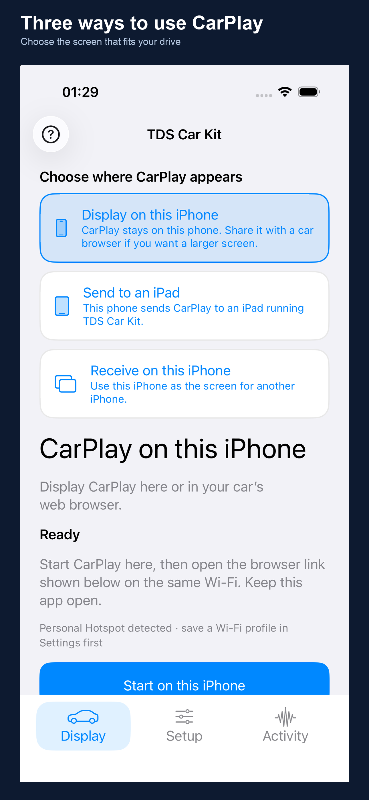
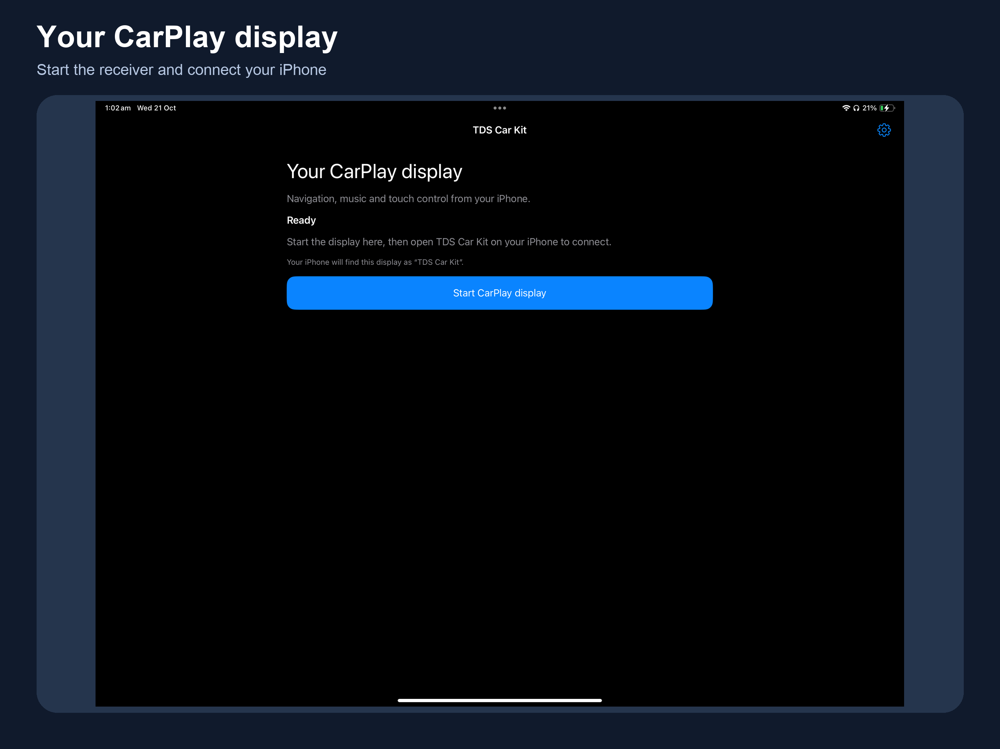

# TDS Car Kit

Use your iPad or iPhone as a CarPlay display. TDS Car Kit can also serve a local
browser display from the receiver's Wi-Fi IP address for an in-car browser such
as Tesla's. The browser receives video and decoded audio and can send touches.





## Features

- A first-run guide explaining each device's role and the Wi-Fi setup.
- Three clear choices on iPhone: display here, send to an iPad, or receive from
  another iPhone. iPad shows a receiver-only screen.
- Full-screen CarPlay on iPad, controlled by touch.
- Music playback through the iPad's speakers.
- Portrait and landscape display layouts.
- An iPhone receiver picker for connecting to your iPad.
- Separate iPad display and iPhone connection screens that adapt to screen width.
- Wi-Fi passwords saved in the device Keychain.
- Display, Setup and Activity tabs, with connection logs and a copy action in Activity.
- CarPlay video and touch on the same iPhone.
- Foreground-only local web display at the receiver's IP address on port 8765,
  with a new six-digit access code each time it starts.
- Optional browser standby: keep the link available while the iPhone app is open,
  then start CarPlay from the browser's **Connect CarPlay** button.
- Browser-started CarPlay uses the browser viewport's aspect ratio and a matching
  display resolution, aligned to 16 pixels and capped at 1920 × 1200.
- Browser touch control and audio output after tapping **Enable audio**.

## Connect

On first launch, read the short guide. Open it again with **How TDS Car Kit
works** in the navigation bar. On iPhone, choose the role you want on the main
screen. The iPad app is always a receiver. Use the **Setup** tab for Wi-Fi and
display options, and **Activity** for connection logs.

1. Connect the iPhone and iPad to the same Wi-Fi network.
2. Open TDS Car Kit on the iPad. Choose the display orientation in Setup,
   enable **Play audio on this device**, then tap **Start CarPlay display**.
3. Open TDS Car Kit on the iPhone. Enter the Wi-Fi name and password in Setup
   once, select your iPad, then tap **Connect to iPad**.
4. Accept the CarPlay prompt and keep both apps open. If the iPhone's system
   Connecting sheet stays visible, dismiss it with **X**.

The iPad receives the network connection without needing the Wi-Fi password in
TDS Car Kit. Use the gear on the full-screen display to return to Setup.

### Why the iPhone asks for Wi-Fi details

For **Display on this iPhone** and **Send to an iPad**, the app passes the Wi-Fi
name and password to iOS during the CarPlay accessory handshake. This
lets iOS establish the CarPlay network path; TDS Car Kit does not join or create
the Wi-Fi network for you. The password is saved only in the device Keychain,
never in diagnostics, and can be removed with **Forget saved Wi-Fi password** in
Setup. A **Done** button above the keyboard returns you to the tabs.
An open network needs no password. The normal iPad receiver path needs no Wi-Fi
password in the app.

## Use a car's web browser

1. Connect the car's browser and iPhone to the same Wi-Fi network. A phone
   Personal Hotspot may work if the car can join it and reach the phone's IP.
2. On the iPhone, choose **Display on this iPhone** and enter the Wi-Fi profile in
   **Setup**. Enable **Play audio on this device** if desired. Turn on **Keep
   browser link ready while app is open** to show the link before CarPlay starts.
3. The app shows a **Browser link** URL such as
   `http://192.168.1.20:8765/?pin=123456`. Tap **Copy browser link** and open
   the exact URL in the car's browser. The six-digit code changes when the web
   listener restarts.
4. Tap **Connect CarPlay** in the browser. The app measures the browser window
   and starts a matching CarPlay display. Accept the iOS CarPlay prompt. Tap
   **Enable audio** in the browser to let it play sound, then use the browser
   screen for touch input.

With browser standby off, start **Display on this iPhone** in the app first;
the browser link then appears while the receiver runs. The web listener stops
when the app leaves the foreground, even when standby is enabled.

The browser page is available while standby is on and the iPhone app is open;
video and audio begin after CarPlay connects. The browser must support
JavaScript, HTTP access to local IP addresses,
and Web Audio. Audio also continues through the receiver's selected iOS output;
use its audio settings if you want to change that route. This local HTTP stream
is intended for a trusted Wi-Fi network. Tesla browser behavior has not yet
been verified in a vehicle.

## Download

Download the compiled IPA from [GitHub Releases](https://github.com/thomasdye12/tds-car-kit/releases/latest).
The IPA includes the accessory authentication files needed by the receiver.
It is **unsigned**: sign it with your own Apple developer account or a compatible
sideloading tool before installing it on an iPhone or iPad.

## Build from source

Use macOS with Xcode and the iOS SDK. The deployment target is iOS/iPadOS 16.4.

1. Open `TDSCarKit.xcodeproj` and select your own signing team and bundle ID.
2. Provide accessory authentication files named `certificate.p7b`, `leaf.cer`,
   and `private.x963`. The build first checks `.local/Identity/`, then
   `../../NativeCarCast/.local/Identity/`. You can set `TDS_IDENTITY_DIR` to an
   absolute directory when building. The build copies these files into the app
   bundle's `Identity/` directory without adding them to Git. An empty or missing
   directory still allows the interface to build, but the receiver cannot start.
3. Choose the `TDSCarKit` scheme and your iPad or iPhone, then build and run.
   Use the **Release** configuration for streaming performance.

When building from source, supply the authentication files separately. The source
tree excludes authentication keys, certificates and provisioning profiles; the
compiled release IPA includes the runtime accessory authentication files.
The app uses private CoreAccessories APIs.

## Screenshots

The images in `docs/screenshots/app-store/` use Apple's accepted 1290 × 2796
iPhone portrait and 2732 × 2048 iPad landscape sizes. The iPhone image shows
the current role picker. The iPad image shows an earlier receiver layout and
needs a fresh capture from the updated app before App Store submission.

## Tests

```sh
bash Tools/test.sh
bash Tools/test_audio.sh
```

The protocol suite covers iAP2, RTSP, pairing, authenticated audio/video framing,
replay protection and format negotiation. Identity-dependent tests skip when local
credentials are absent. Audio checks exercise AAC-LC, Opus and PCM conversion
using synthetic tones.

The listener integration check requires local authentication material:

```sh
bash Tools/test_listener.sh
```

## Source layout

- `App/`: UIKit interface, receiver, networking, playback and iPhone companion.
- `Sources/TDSCarKitCore/`: protocol parsing, cryptography and packet framing.
- `Sources/CTDSCarKitCrypto/`: native cryptographic helpers.
- `Tests/TDSCarKitCoreTests/`: protocol tests.
- `Tools/`: project generation, builds and automated checks.

## License

GPL-3.0-or-later. See [LICENSE](LICENSE) and
[THIRD_PARTY_NOTICES.txt](THIRD_PARTY_NOTICES.txt) for the license and third-party
credits. Vendored BigInt is MIT-licensed; its license is in `ThirdParty/`.
